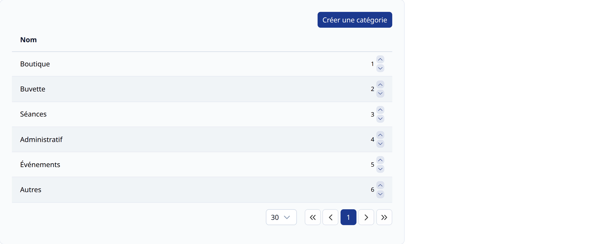
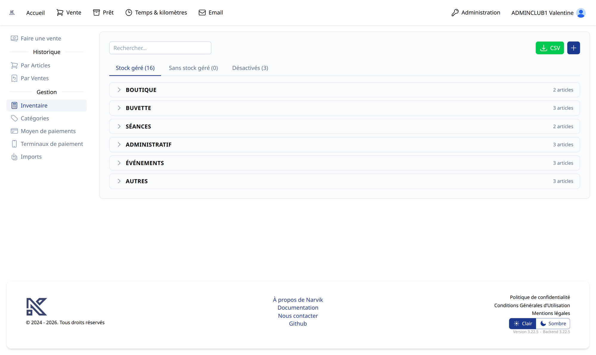
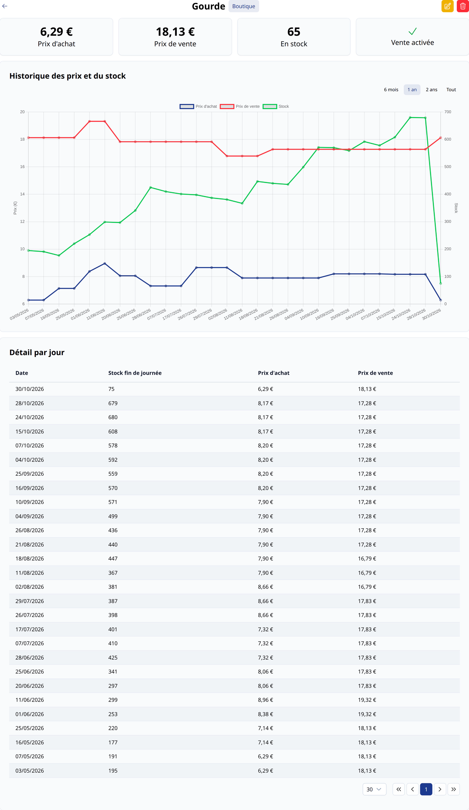

# Gestion de l'inventaire <BundleComponent bundle="sales" /> <RoleLevelComponent level="admin" />

La configuration de l'inventaire est faite sur 2 pages

- Catégories
  - Création
  - Changement de l'ordre (pour mettre en avant les licences lors de la période de renouvellement)
- Inventaire (création d'article)

## Catégories <RoleLevelComponent level="admin" />
> URL : https://narvik.app/admin/inventories/categories

::: warning Suppression
La suppression d'une catégorie n'est possible que si et seulement si celle-ci ne dispose d'aucun article.
:::

Le changement d'ordre d'une catégorie s'effectue en cliquant sur les fléches bleue située à droite dans le tableau.

## Inventaire <RoleLevelComponent level="admin" />

### Listing
> URL : https://narvik.app/admin/inventories

Les articles sont regroupés par catégorie, chaque catégorie pouvant être dépliée ou repliée en cliquant sur son nom (le nombre d'articles et le nombre d'alertes de stock y sont affichés).

Trois onglets permettent de filtrer la liste :

- **Stock géré** : les articles dont la quantité en stock est suivie
- **Sans stock géré** : les articles dont la quantité n'est pas suivie (ex : un droit d'entrée)
- **Désactivés** : les articles qui ne sont plus vendus, un bouton `Réactiver` permet de les remettre en vente

La barre de recherche filtre sur le nom de l'article, et peut aussi utiliser la caméra pour scanner un code-barres.
Le bouton `CSV` exporte l'inventaire et le bouton `+` permet de créer un article.

Pour chaque article, il est possible d'augmenter ou de diminuer directement la quantité en stock depuis la liste.
Lorsque le stock atteint le seuil d'alerte défini (`alerte ≤ N`), celui-ci est affiché en rouge.

Lors de la sélection d'un article apparaît, sur le côté droit de la page, son formulaire d'édition ainsi qu'un bouton `Voir en détail`.
Le bouton `Détails` situé sur la ligne de l'article redirige directement sur la [fiche complète](#fiche-produit).

## Fiche produit

Cette page permet d'avoir une vue détaillée pour un produit.

Il est possible de voir rapidement le prix d'achat, le prix de vente, le nombre en stock et si la vente de celui-ci est activée.

L'édition ou la suppression est possible en cliquant sur les boutons situés en haut à droite de la page.

Un graphique affiche l'évolution des prix d'achats et de ventes ainsi que du stock, avec une sélection de la période (6 mois, 1 an, 2 ans, tout).
Un tableau `Détail par jour` complète cette vue.
