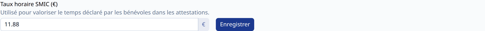
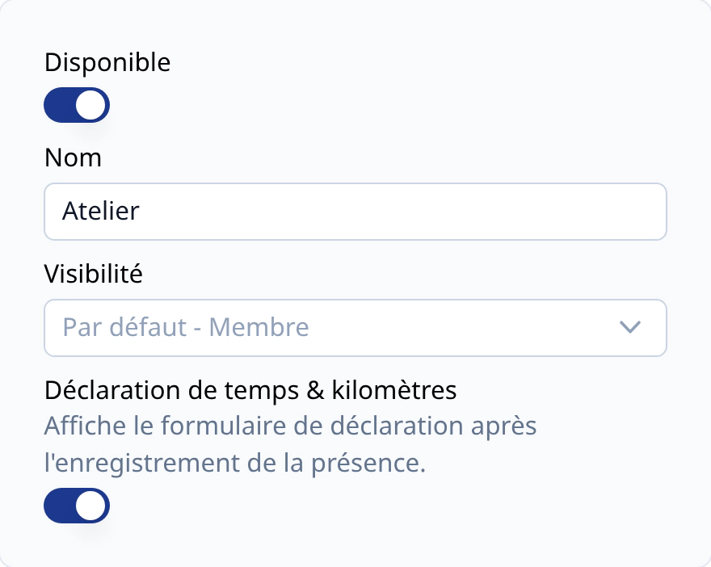
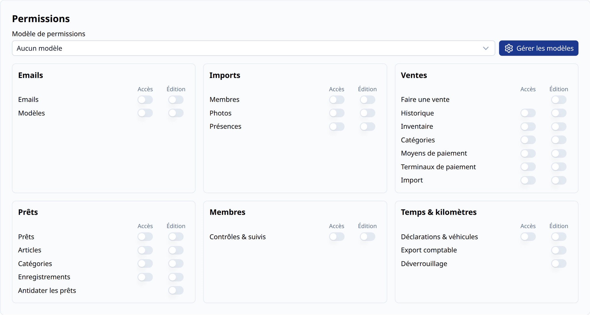
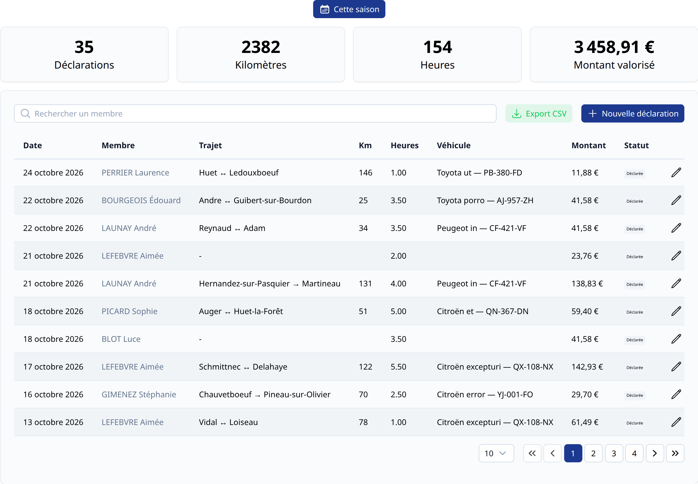
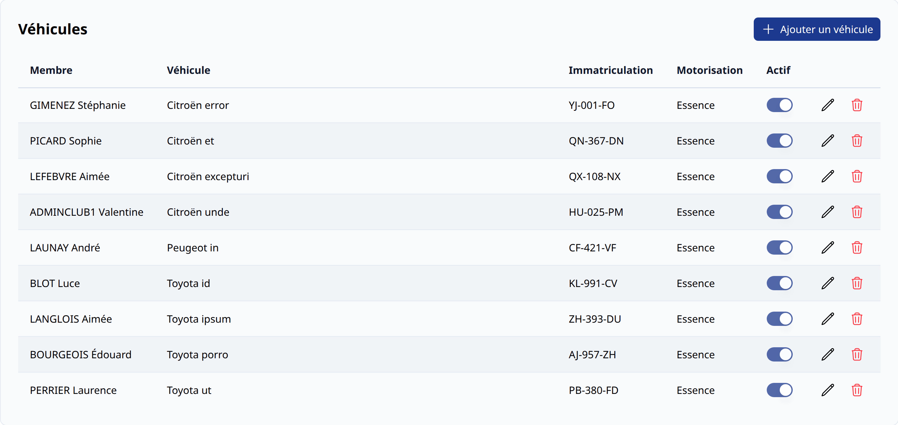
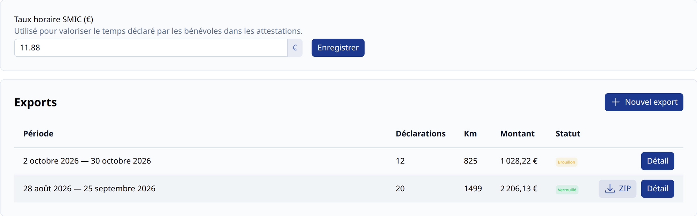
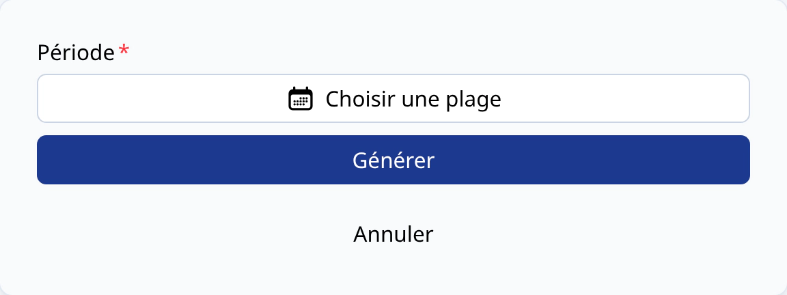
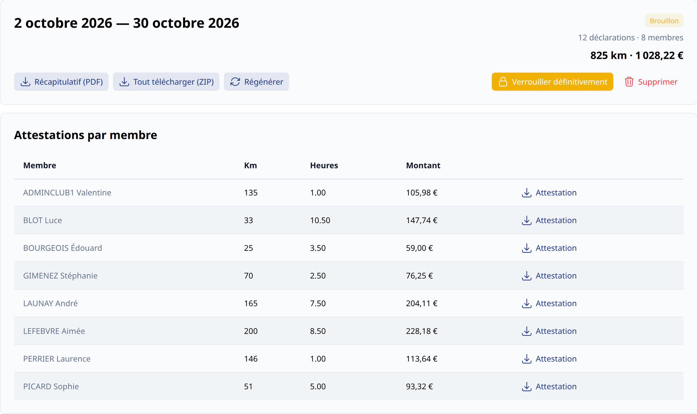
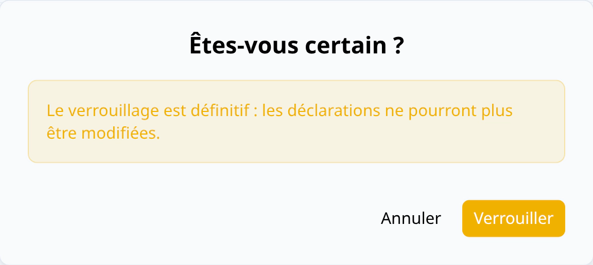

# Configuration Temps & kilomètres <BundleComponent bundle="time-and-travel" /> <RoleLevelComponent level="admin" />

Le module Temps & kilomètres permet aux bénévoles de déclarer les heures passées et les kilomètres
parcourus pour le club, puis de générer des récapitulatifs et des attestations par période.

La mise en place se fait en 3 étapes

- Activer le module
- Définir le taux horaire du SMIC
- Choisir les activités qui déclenchent une déclaration

<BundleComponent bundle="time-and-travel" alert />

## Taux horaire du SMIC <RoleLevelComponent level="admin" />

> URL : https://narvik.app/admin/time-and-travel/exports

Ce taux sert à valoriser le temps déclaré par les bénévoles dans les attestations. Il est
enregistré en cliquant sur le bouton `Enregistrer`, et reste modifiable à tout moment.

::: warning Taux utilisé
Le taux est figé au moment de la génération d'un export : le modifier n'a pas d'effet sur les exports déjà générés.
Utilisez le bouton [`Régénérer`](#regenerer-un-export) pour appliquer le nouveau taux à un export non verrouillé.
:::

## Déclaration lors de la présence <RoleLevelComponent level="admin" />

> URL : https://narvik.app/admin/config/activities

Sur chaque [activité](/frontend/docs/activites/administration), l'interrupteur
`Déclaration de temps & kilomètres` (visible uniquement lorsque le module est activé) affiche le
formulaire de [déclaration](./declarations#declarer-du-temps-et-des-kilometres) juste après
l'enregistrement d'une présence sur cette activité.

Pratique pour les activités comme `Travaux`, `Bureau` ou `Permanence`.

## Permissions <RoleLevelComponent level="admin" />

Les administrateurs ont accès à l'ensemble du module. Pour les superviseurs, les permissions
du bloc `Temps & kilomètres` peuvent être attribuées depuis l'onglet `Permissions` de la fiche du membre :

| Permission                         | Permet de                                                                         |
|------------------------------------|-----------------------------------------------------------------------------------|
| Déclarations & véhicules - Accès   | Consulter les déclarations et véhicules de tous les membres                       |
| Déclarations & véhicules - Édition | Créer, modifier ou supprimer les déclarations et véhicules à la place d'un membre |
| Export comptable                   | Générer, régénérer et verrouiller un export                                       |
| Déverrouillage                     | Déverrouiller ou supprimer un export verrouillé                                   |

::: info
Chaque permission inclut celles qui la précèdent : `Déverrouillage` donne aussi `Export comptable` et l'accès aux déclarations, `Export comptable` donne aussi l'accès aux déclarations.
:::

## Déclarations <RoleLevelComponent level="supervisor" />

> URL : https://narvik.app/admin/time-and-travel

Cette page regroupe les déclarations de tous les membres du club, avec pour chacune la date, le
membre, le trajet, les kilomètres, les heures, le véhicule, le montant et le statut (modifiable ou verrouillé).

Le bouton `+` permet de créer une déclaration pour un membre : il faut d'abord choisir le membre,
puis remplir le [formulaire](./declarations#declarer-du-temps-et-des-kilometres).

Les déclarations d'un membre sont aussi visibles depuis l'onglet `Déclarations` de sa fiche (uniquement pour les superviseurs et administrateurs).

## Véhicules <RoleLevelComponent level="supervisor" />

> URL : https://narvik.app/admin/time-and-travel/vehicles

Liste des véhicules déclarés par les membres. Voir [Mes véhicules](./declarations#mes-vehicules) pour le détail des champs.

## Exports <RoleLevelComponent level="admin" />

> URL : https://narvik.app/admin/time-and-travel/exports

Un export regroupe toutes les déclarations d'une période et génère :

- Un **récapitulatif général** au format PDF
- Une **attestation PDF par bénévole**
- Une **archive ZIP** contenant l'ensemble (disponible une fois l'export verrouillé)

::: info Permission
Cette page est accessible aux administrateurs, ainsi qu'aux superviseurs disposant de la
permission `Export`.
:::

### Générer un export

Le bouton `Nouvel export` ouvre une fenêtre dans laquelle il suffit de choisir la **période**,
puis de cliquer sur `Générer`.

::: warning Chevauchement
Deux exports ne peuvent pas se chevaucher : une période déjà couverte par un autre export est refusée.
:::

La génération est réalisée en arrière-plan. Tant qu'elle est en cours, le badge `Génération en cours…`
est affiché ; en cas de problème, il est remplacé par `Échec de la génération` et il suffit de régénérer l'export.

### Fiche d'un export

Un clic sur `Détail` affiche la fiche de l'export.

- La période, le nombre de déclarations et de membres, le total des kilomètres et le montant
- Le bouton `Récapitulatif (PDF)`
- Le bouton `Tout télécharger (ZIP)` (export verrouillé)
- La liste des attestations de chaque bénévole, téléchargeables une par une

Un export a deux statuts :

- **Brouillon** : les déclarations de la période peuvent encore être modifiées
- **Verrouillé** : l'export est figé

### Régénérer un export

Tant que l'export est en brouillon, le bouton `Régénérer` recalcule les documents avec les
déclarations et le taux horaire actuels.

::: info
Lorsqu'une déclaration d'un export en brouillon est modifiée, ses documents sont automatiquement régénérés.
:::

### Verrouiller un export

Le bouton `Verrouiller définitivement` fige l'export : les documents sont générés une dernière
fois, l'archive ZIP est créée, et **les déclarations de la période ne peuvent plus être modifiées ni supprimées**.

### Déverrouiller / supprimer un export

Un export verrouillé peut être déverrouillé (bouton `Déverrouiller`) ou supprimé par un
administrateur, ou par un superviseur disposant de la permission `Déverrouillage`.
Les déclarations redeviennent alors modifiables.
