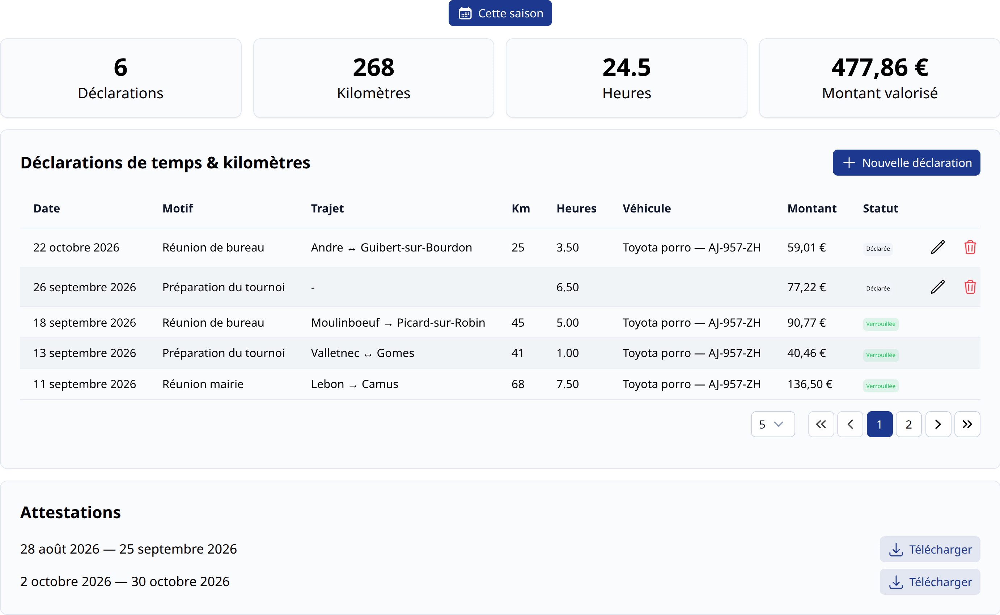
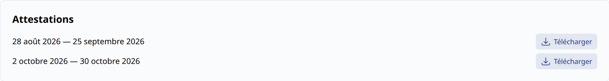
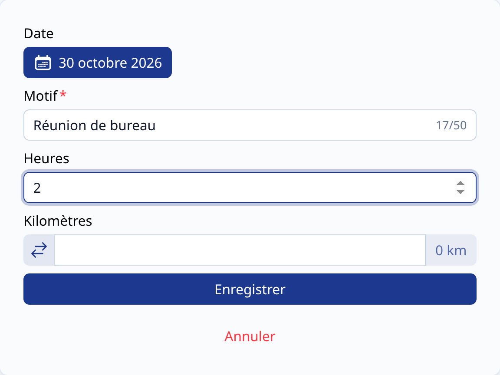
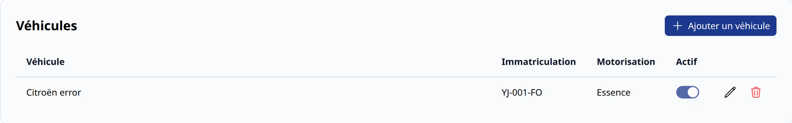
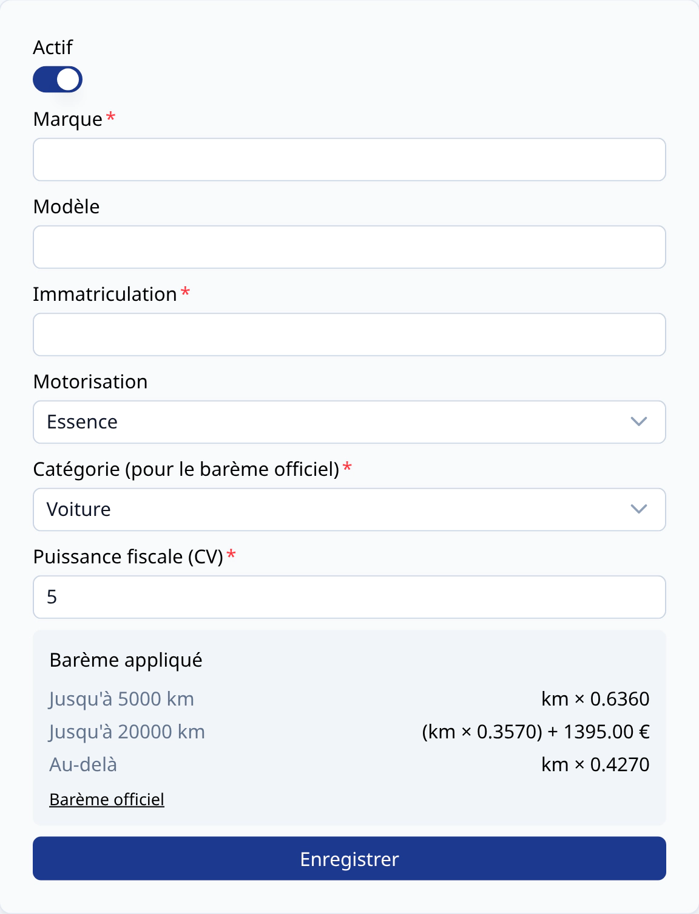

# Déclarations de temps & kilomètres <BundleComponent bundle="time-and-travel" /> <RoleLevelComponent level="supervisor" />

Chaque bénévole (superviseur ou administrateur) peut déclarer le temps passé et les kilomètres
parcourus pour le club, afin d'obtenir une attestation en fin de période.

Le bouton `Temps & kilomètres` du menu supérieur donne accès à son espace personnel, composé de
deux pages : [Mes déclarations](#mes-declarations) et [Mes véhicules](#mes-vehicules).

<BundleComponent bundle="time-and-travel" alert>

Voir la [configuration](./administration) du module.

</BundleComponent>

## Mes déclarations <RoleLevelComponent level="supervisor" />
> URL : https://narvik.app/time-and-travel

Le tableau liste les déclarations du bénévole : date, motif, trajet, kilomètres, heures,
véhicule, montant et statut. Les déclarations incluses dans un export verrouillé ne sont plus modifiables.

Sous le tableau, la section `Attestations` permet de télécharger les attestations PDF générées
par le club pour chaque période exportée.

### Déclarer du temps et des kilomètres
Une déclaration peut être créée depuis le bouton d'ajout, ou apparaît automatiquement après
l'enregistrement d'une présence sur une [activité configurée](./administration#declaration-lors-de-la-presence).

Le formulaire dispose des champs suivants :

- **Date**
- **Motif** (obligatoire, texte court décrivant la mission)
- **Heures** : par pas de 30 minutes (1 ; 1,5 ; 2...), 24 h maximum
- **Kilomètres** : 10 000 km maximum
- **Aller simple / aller-retour** : le bouton à côté des kilomètres bascule entre les deux modes. En aller-retour, la distance saisie est doublée
- **Lieu de départ** et **lieu d'arrivée** (obligatoires dès que des kilomètres sont saisis)
- **Véhicule** (obligatoire dès que des kilomètres sont saisis)

::: warning Heures ou kilomètres
Une déclaration doit comporter au minimum des heures **ou** des kilomètres.
:::

::: warning Période verrouillée
Il n'est pas possible de créer ou modifier une déclaration à une date couverte par un export verrouillé.
:::

Le **montant** est calculé automatiquement :

- Les **kilomètres** sont valorisés selon le barème kilométrique officiel, en fonction de la catégorie
  du véhicule, de sa puissance fiscale et du total de kilomètres parcourus sur la période. Les
  véhicules électriques bénéficient de la majoration légale (+20 % par défaut).
- Les **heures** sont valorisées au [taux horaire du SMIC](./administration#taux-horaire-du-smic) défini par le club.

## Mes véhicules <RoleLevelComponent level="supervisor" />
> URL : https://narvik.app/time-and-travel/vehicles

Avant de déclarer des kilomètres, le bénévole doit enregistrer au moins un véhicule. Un véhicule dispose des champs suivants :

- **Marque** et **modèle**
- **Immatriculation**
- **Motorisation** : essence, diesel, électrique ou hybride
- **Catégorie** (pour le barème officiel) : voiture, moto ou cyclomoteur
- **Puissance fiscale** (CV)
- **Actif** : un véhicule désactivé n'est plus proposé lors d'une nouvelle déclaration

::: info Administration
Les administrateurs retrouvent les déclarations et véhicules de tous les membres dans la partie
[Gestion](./administration#declarations) du module.
:::
